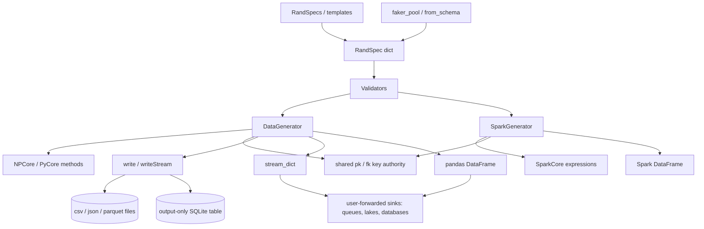

## Atomic view

rand-engine generates synthetic data very fast, for any platform and any sink, from a declarative
RandSpec: the NumPy core ([[data-generator]]) yields pandas DataFrames, record streams and files
([[writers-and-streaming]]) the user forwards to any queue, lake, database or file; Spark is
supported through the same spec ([[spark-generator]]). Correlated columns and pattern strings
([[generation-methods]]), stateless PK/FK relations ([[pk-fk-constraints]]) and
ready-made specs ([[templates-and-examples]]) sit on a vectorized NumPy core. A new user starts from
a scaffolded example ([[get-started-cli]]) and the docs site, `llms.txt` and agent skill
([[documentation]]).

## Users

| User | Description |
|------|-------------|
| Data engineers | Learn, stress-test pipeline throughput and bandwidth, and feed pipeline tests with synthetic data — batch or streaming, to any sink. |
| QA engineers | Build reproducible, relation-aware fixtures without hand-written data. |
| Developers and learners | Mock data for apps and demos from prebuilt specs, guided by validation messages that show a correct example. |

## Feature catalog

### api

| slug | title | tldr |
|------|-------|------|
| `public-api` | Public API | rand_engine exports DataGenerator, SparkGenerator, RandSpecs and __version__, is typed and ships the rand-engine CLI; every other module is internal. |

### content

| slug | title | tldr |
|------|-------|------|
| `templates-and-examples` | Templates and examples | Ready RandSpecs (ten cross-engine, ten pandas-only), a UTC WebServerLogs template, and Faker-pool and Arrow-schema spec builders. |

### generation

| slug | title | tldr |
|------|-------|------|
| `data-generator` | DataGenerator | The pandas generator validates a RandSpec, owns its random generator, and returns DataFrames, files, file streams or an endless lossless record stream. |
| `generation-methods` | Generation methods | Ten common methods run on pandas and Spark; pk/fk share one indexed authority; distributions, correlated methods, constants and modifiers are pandas-only. |
| `spark-generator` | SparkGenerator | The Spark generator builds ordinary columns with native expressions and stateless pk/fk columns through the shared indexed key authority. |

### onboarding

| slug | title | tldr |
|------|-------|------|
| `documentation` | Documentation site, llms.txt and agent skill | Strict-built docs, README, llms.txt and Agent guidance cover APIs, tutorials, compatibility, migration, support and security routes. |
| `get-started-cli` | Get-started CLI | The rand-engine console script lists six starters: five runnable Python examples and one opt-in AGENTS.md project context. |

### output

| slug | title | tldr |
|------|-------|------|
| `writers-and-streaming` | Writers and streaming | DataGenerator writes CSV, JSON lines, Parquet or an output-only SQLite table through a Spark-style builder; file streams support the three file formats. |

### quality

| slug | title | tldr |
|------|-------|------|
| `benchmarks` | Performance benchmarks | CI enforces same-runner rand-engine regression limits and separately records bounded, validated observations against Faker and dbldatagen. |

### relations

| slug | title | tldr |
|------|-------|------|
| `pk-fk-constraints` | PK/FK key columns | Stateless pk and fk column methods create related tables from definitions, seeds and row indexes on pandas and Spark, without a checkpoint store. |

### spec

| slug | title | tldr |
|------|-------|------|
| `rand-spec-grammar` | RandSpec grammar | A RandSpec maps output columns to a method, named kwargs and optional cols, transformers or modifiers, validated through one method catalog. |

## Capability map

## Known limits

- The `exponential`, `lognormal`, `poisson` and `zipf` distributions, constants, null and anomaly modifiers and transformers run on pandas only. Spark runs the ten common methods and accepts `pk` and `fk`; it refuses the four correlated methods and the other NumPy-only methods as NumPy engine only.
- A seed controls pandas values and keys. On Spark, ordinary columns remain unseeded and an explicit seed controls only `pk` and `fk`.
- PK/FK relations are stateless: parent and child link through definitions, seeds and row indexes, including optional event-time eligibility, with no stored keys or database lookup.
- Built-in sinks are CSV, JSON-lines and Parquet files plus an output-only SQLite batch table. Queues, object storage and other databases are reached by forwarding DataFrames or `stream_dict` records.
- pandas generation runs in one process and holds one frame in memory: the whole size for `get_df`, one row batch at a time per file when `maxRowsPerBatch` is set.
